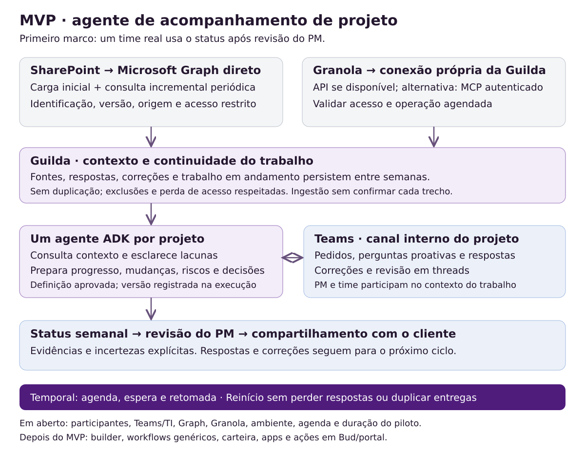

# Guilda — RH para Digital Workers

A visão da Guilda é dar às empresas uma forma de contratar, orientar, avaliar e desligar
Digital Workers. Cada Digital Worker é um agente de IA com identidade duradoura na
organização. Pessoas e workflows podem acionar o mesmo especialista. Cada conversa
privada mantém seu histórico, e o acesso aos dados respeita as permissões de quem o aciona.

Ao contratar um Digital Worker, a empresa define por quais entregas ele responde e
quem avalia seu trabalho. O engenheiro de implantação (FDE) configura seu comportamento,
os workflows, as ferramentas e os limites de autonomia. O gestor avalia a qualidade e
a pontualidade das entregas para ajustar as responsabilidades do especialista. No
desligamento, a empresa encerra seus acessos e agendamentos, transfere as pendências
e preserva a autoria do trabalho entregue.

**BRQ@work é a instalação da Guilda na BRQ.** Ela reunirá vários Digital Workers.
O primeiro, no piloto, é o especialista de acompanhamento de projeto que prepara o
relatório semanal para revisão do PM.

## Repositório

Monorepo do kernel Guilda e suas distribuições, incluindo BRQ@work.
O kernel está em construção, em fatias verticais (ver o roadmap); spikes são experimentos isolados.

## Conteúdo

- [PRD v0.27](guilda-brq-work-prd.html) e [escopo do MVP: acompanhamento de projeto](guilda-brq-work-prd.html#mvp)
- [Roadmap](ROADMAP.md) e [backlog](BACKLOG-KERNEL.md)
- [Decisões de arquitetura](docs/adr/)
- [Ontologia e governança](spikes/ontology-governance/README.md)
- [Graphiti](spikes/graphiti-memory/README.md) e [Hindsight](spikes/hindsight-memory/README.md)

## Primeiro marco: piloto com um time real

Um agente por projeto acompanha a semana, esclarece lacunas em threads no Teams e prepara
um status revisável pelo PM, usando contexto contínuo de SharePoint e Granola. O agente é
configuração da BRQ@work (instruções, ferramentas e agenda), publicada com aprovação; o
kernel monta o agente ADK com o modelo do gateway, e o Temporal cuida de agenda, espera e
retomada. ADK, Temporal e LinkML permanecem; a distro configura o agente e o ciclo semanal, e o
kernel monta o agente e conduz o ciclo. A recuperação do Hindsight será ampliada, e só o
report revisado pelo PM vira fato canônico. Envio autônomo por e-mail ou
WhatsApp é evolução futura, condicionada à autorização de execução
([ADR 0006](docs/adr/0006-arquitetura-do-agente-especialista.md)). Builder e kernel completo ficam como evolução posterior. Acessos, ambiente,
participantes e agenda ainda são [dependências abertas](guilda-brq-work-prd.html#mvp-dependencias).



Diagrama: [PNG](docs/diagrams/mvp-acompanhamento.png) · [fonte SVG](docs/diagrams/mvp-acompanhamento.svg).
Em terminal com protocolo Kitty, por exemplo: `kitten icat docs/diagrams/mvp-acompanhamento.png`.

## Desenvolvimento

O código de produto fica em `guilda-kernel/` (kernel) e `brq-at-work/` (distribuição),
num workspace uv com Python 3.12. A fronteira entre os dois está nos ADRs 0002 e 0003.

```sh
uv sync
docker compose up -d --wait   # Postgres 16 + pgvector em 127.0.0.1:25432
uv run ruff check guilda-kernel brq-at-work
uv run ruff format --check guilda-kernel brq-at-work
uv run mypy
uv run lint-imports          # o kernel não importa a distribuição
uv run pytest                # neutralidade e integração; exige o Postgres do Compose
```

Os testes de workflow sobem o servidor de desenvolvimento do Temporal (`temporal_testing.py`,
versão fixa). O SDK baixa o binário na primeira execução, que por isso precisa de rede.

Modelos Pydantic e JSON Schema são gerados do LinkML de cada pacote (`generated.py` e
`generated.schema.json`, ao lado do `ontology.yaml`). Depois de mudar uma ontologia:

```sh
uv run python -m guilda_kernel.ontology.generate guilda-kernel/tests/retail_fixture \
  guilda-kernel/src/guilda_kernel/agents/package
```

O teste de snapshot e o CI (`--check`) falham se o gerado divergir do LinkML.

No CI, a memória de contexto é o adaptador falso. A execução real é opt-in e local, com o
Hindsight sobre o Postgres do Compose e o modelo no Vertex (gasta tokens no projeto
indicado):

```sh
cp .env.example .env  # e preencha a rota de modelos
GOOGLE_APPLICATION_CREDENTIALS=... scripts/hindsight-local.sh
GUILDA_HINDSIGHT_URL=http://127.0.0.1:18888 uv run pytest -k hindsight
```

Provedor, modelos e regiões são decisão de deploy: o FDE os define por cliente no ambiente
(`GUILDA_MODEL_PROVIDER`, `GUILDA_MODEL`, `GUILDA_MODEL_REGION`, `GUILDA_MEMORY_*` e
`GUILDA_EMBEDDING_*`; modelo em [.env.example](.env.example)), e nada disso é fixo no código. O
bootstrap grava a rota recebida (`route=Route.from_environment()`), um novo deploy a
substitui, e sem rota a instalação não recebe modelo. O gateway entrega ao agente ADK um
modelo preso a essa rota, e o script do Hindsight tira da mesma rota o modelo, os embeddings e
as regiões. A validação da rota configurada no Vertex é opt-in e gera cobrança; os resultados
estão em [docs/validacoes](docs/validacoes/2026-11-14-rotas-vertex.md):

```sh
set -a; . ./.env; set +a
GOOGLE_APPLICATION_CREDENTIALS=... uv run pytest guilda-kernel/tests/test_vertex_routes.py
```

O MCP, a política de ação de agentes e o escriba saíram do código em 15/11/2026, por estarem
fora do MVP ([ADR 0005](docs/adr/0005-poda-para-o-mvp.md)). Os sete cenários de aceitação do
MVP estão em `brq-at-work/tests/test_mvp_scenarios.py`, como falha esperada estrita até cada
fatia entregá-los. Um banco local criado antes disso precisa ser recriado, porque a cadeia de
migrações foi editada.

O CI de produto (`.github/workflows/ci.yml`) roda os mesmos checks. Os experimentos em
`spikes/` ficam fora do workspace e do CI; seus procedimentos estão nas respectivas pastas.

Veja [contribuição](CONTRIBUTING.md), [segurança](SECURITY.md) e [Apache-2.0](LICENSE).
